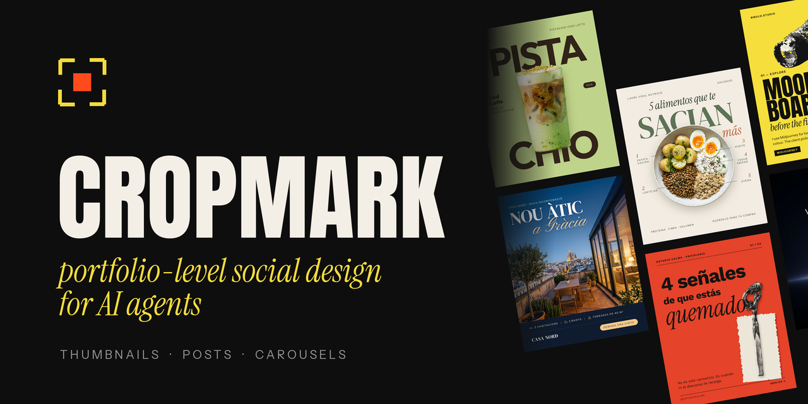
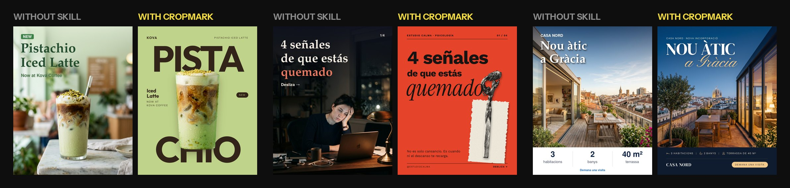
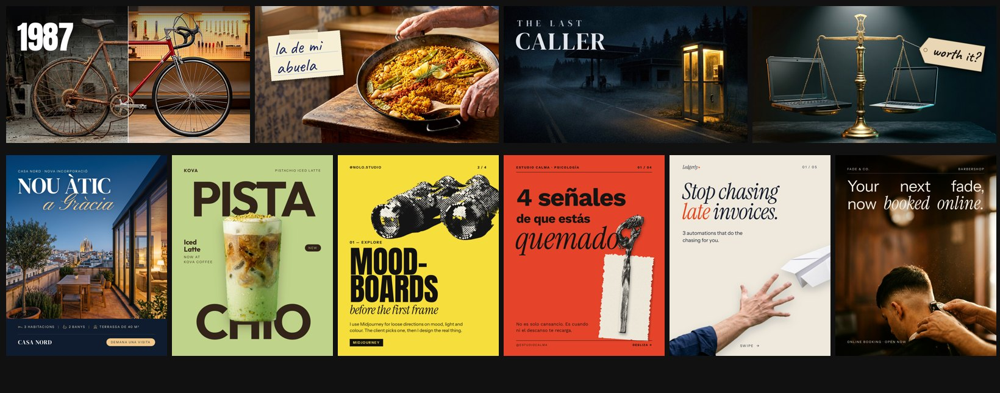

<p align="center">
  
</p>

<h1 align="center">cropmark</h1>

<p align="center">
  <em>Your agent designs thumbnails, posts and carousels that could sit in a Behance portfolio, not a template with a stock photo.</em>
</p>

<p align="center">
  <a href="LICENSE"></a>
  &nbsp;
  <a href="https://github.com/vercel-labs/skills"></a>
  &nbsp;
  <a href="#install"></a>
  &nbsp;
  <a href="CHANGELOG.md"></a>
</p>

<p align="center"><sub><a href="#install">Install</a> · <a href="#update">Update</a> · <a href="#what-it-makes">What it makes</a> · <a href="#before--after">Before / after</a> · <a href="#styles">Styles</a> · <a href="#how-it-works">How it works</a> · <a href="#results">Results</a> · <a href="#faq">FAQ</a></sub></p>

## Art-direction candidate (unreleased)

This branch implements an art-direction workflow on the frozen rc5 rendering base. It adds three concepts/two visual sketches for original work, subject-specific reference analysis, fourteen observable craft rules with illustrated exceptions, a 21-project reference atlas, campaign guidance and optional declared-layout checks. The workflow and review loop adapt to available tools and explicit budget.

**Not accepted for release.** The published/installed version remains v0.4; rc5's historical 4/6 result is not evidence for this new workflow. Current calibration compares no skill, frozen rc5 and a frozen candidate on three new development briefs at low/high effort. The first human calibration rejected art-direction-rc1 at low effort (0/3 acceptable) and accepted 1/3 at high effort. Subsequent development repairs address recorded process, padding, grouping and hierarchy failures; the six-brief held-out phase has completed all18 trials/48 PNGs and passed its technical file audit. Final human blind review and the publication gate remain pending. [Held-out scope](docs/heldout-results.md). [Calibration and repairs](docs/calibration-results.md). [Protocol](evals/art-direction/protocol.md).

- [Creative workflow](docs/visuals/creative-flow.svg) · [PNG](docs/visuals/creative-flow.png) · [editable Mermaid](docs/visuals/creative-flow.mmd)
- [Visual rules](skills/cropmark/references/visual-rules.md) · [illustrated manual](skills/cropmark/references/rulebook.html)
- [Reference atlas](skills/cropmark/refs/atlas.md) · [provenance-backed casebook](skills/cropmark/references/casebook.md)

The install commands below refer to the public stable branch, not automatic acceptance of this candidate.

## Install

```bash
npx skills add jdann1el/cropmark
```

The [`skills`](https://github.com/vercel-labs/skills) CLI asks which agents to install it for: Claude Code, Codex, Cursor, OpenCode, Gemini CLI, Hermes and 70+ more. Add `-g` to install it for every project.

**Claude Code plugin** (optional, the only way to get automatic updates):

```
/plugin marketplace add jdann1el/cropmark
/plugin install cropmark@cropmark
```

**Render engines** (one time, from the installed `cropmark/` folder):

```bash
pip install pillow
cd engines/html && npm i && npx playwright install chromium
```

## Update

```bash
npx skills update cropmark
```

Claude Code plugin: run `/plugin marketplace update cropmark`, or turn on auto-update in `/plugin` → Marketplaces → cropmark.

## What it makes

| Format | Size | What the skill handles |
| --- | --- | --- |
| **YouTube thumbnail** | 1280×720 | One idea told by the image, a 2–4 word hook, bottom-right kept clear for the timestamp, 320 px readability check |
| **Post / ad** | 1080×1350 · 1080×1080 | Photo-led or type-led layouts, brand used as a graphic element, Instagram and LinkedIn crops |
| **Carousel** | 4:5 slides | Built as an argument in chapters: cover, proof, payoff. Templated systems or one seamless panorama sliced into slides |
| **Upgrade mode** | any | Takes an existing weak piece, diagnoses it and ships a before/after |

Ask in plain words: *"make a thumbnail for my video about restoring a 1987 road bike"*, *"carousel: 4 signs you're burnt out, for a psychology studio"*, *"fix this post"*.

## Before / after

The images below are historical examples. They are not controlled evidence that the local v0.5 candidate outperforms v0.4 or matches Hark. The candidate is under the bounded protocol described in [evals](evals/README.md).

Same agent, same brief, same image model. Left: no skill. Right: cropmark.

<p align="center"></p>

<p align="center"></p>

## Styles

18 retained card paths now describe optional mechanisms and resource needs. Original concepts are selected from the brief and inspected references; a campaign can combine mechanisms within one coherent visual system.

| Photo-led | Type-led | Commercial |
| --- | --- | --- |
| `cinematic-stakes` · `horror-mystery` · `food-hero` · `dark-food-punchline` · `luxury-realestate` · `seamless-panorama` | `editorial-maximal-yellow` · `zine-collage` · `type-behind-subject` · `cinematic-editorial` · `brand-color-block` · `brand-shape-mask` | `product-hero-dark` · `ui-hero` · `split-transformation` · `text-in-scene` · `surreal-object` · `promo-mid` |

## How it works

```
brief + assets → subject inventory + references → 3 concepts → 2 visual sketches → representative piece → complete set → inspect + correct (max 3 rounds) → editable delivery
```

- **Router, not a wall of text.** `SKILL.md` is short and loads only the format, style and techniques the task needs.
- **Text is never generated by the image model.** Bases come out clean; type is set with real fonts (20+ OFL fonts bundled).
- **Two engines.** `engines/pillow/cm.py` for photo-led pieces (grading, in-scene cards, sticky notes, halftone, torn paper, cutout cleanup). `engines/html/render.mjs` for layout-heavy posts and carousels (HTML/CSS → PNG, panoramas sliced automatically).
- **QA you can run.** `qa/qa.py` checks size, safe zones, the timestamp corner, contrast and word count, and outputs feed-size previews.
- **No invented numbers.** Prices, stats and claims come from the brief or stay out.
- **Capability-aware.** Use available honest assets or a deliberate typographic route when generation is absent; disclose any unverified visual checks.

<details>
<summary>Repo layout</summary>

| Path | What |
| --- | --- |
| `skills/cropmark/SKILL.md` | Router and non-negotiables |
| `skills/cropmark/formats/` | thumbnail, post, carousel, other (story, X, square) |
| `skills/cropmark/styles/` | 18 style cards + `INDEX.md` |
| `skills/cropmark/techniques/` | story in one frame, typography, carousel system, upgrade, imagery |
| `skills/cropmark/engines/` | Pillow and HTML render engines |
| `skills/cropmark/qa/` | `qa.py`, checklist, rubric |
| `skills/cropmark/adapters/` | notes for Claude Code, Codex, generic agents |
| `evals/` | the frozen briefs used to test the skill |

</details>

## Historical results

The figures below describe earlier versions. Current art-direction quality awaits human calibration and held-out evaluation.

12 frozen briefs, same agent with and without the skill:

- **Blind human vote:** cropmark won 9 of 12 pairs, 1 tie.
- **Rubric score** (7 criteria, self-scored): 3.3 → 4.2. Unseen hold-out briefs: 4.1.

Both losses were thumbnails where the skill dropped all text; v0.3.1 fixed that rule. The briefs are in [`evals/`](evals/), so you can run your own comparison.

## FAQ

**Does it need an image generator?**
No. It uses one if your agent has it (for text-free bases), otherwise your photos, free stock or type-only styles.

**Why did the installer show a security warning?**
The skill runs local scripts (Pillow, Playwright) to render images, which some automated scanners flag. It only reads its own folder and your assets, writes images to your output folder, and never installs anything without asking. The scripts are short: read them in `skills/cropmark/engines/`.

**Can it copy a specific designer?**
No. Styles describe patterns (layout, type contrast, depth), not anyone's work. No third-party images ship in the repo.

**Languages?**
The copy matches the brief: English, Spanish, Catalan and others.

## Contributing

Issues and PRs welcome: new style cards, format modules, engine fixes. See [CONTRIBUTING.md](CONTRIBUTING.md).

## License

[MIT](LICENSE) for code and docs. Bundled fonts keep their SIL OFL 1.1 licenses. Ideas, not code, from anthropics/skills `canvas-design`, op7418 guizang social cards and charlie947 social-media-skills.

<p align="center"><sub>Made by <a href="https://github.com/jdann1el">@jdann1el</a> in Barcelona</sub></p>
