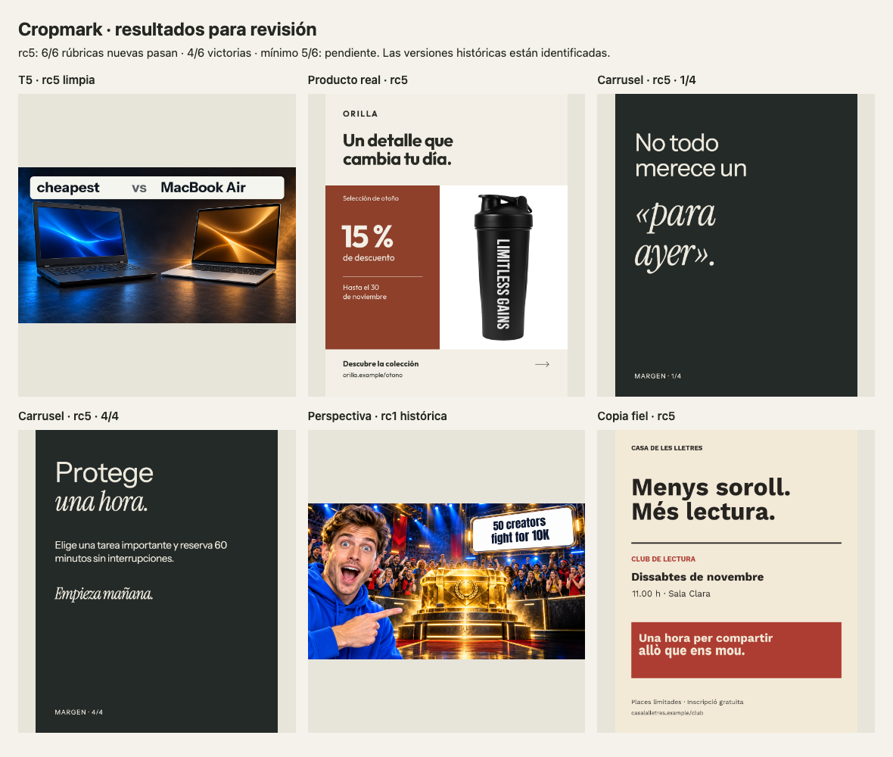

# v0.5 rc5: practical validation outcome

Status: **not accepted**. All 13 executions in the final closure plan completed with GPT-6.1 Sol / low. Six new briefs were run once with v0.4 and once with rc5; the remaining execution was a clean T5 rc5 regression against a retained v0.4 comparator.

The candidate passes the individual rubric/content gates on all six new briefs, but wins only 4/6 pairs against the prespecified 5/6 threshold. C03 (typographic carousel) and C05 (faithful typography copy) prefer v0.4. Both C05 alternatives score fidelity 4/5 and have real editing/rerender evidence. C06 rc5 preserves the supplied product photo; v0.4 has a visible pale cutout fringe. No reruns were added to seek wins. These six briefs are now seen development material, not fresh holdout for another candidate.

T5 rc5 passes at 4.14/5 with conceptual hardware imagery and complete contender labels. Known-case development coverage combines rc1/rc3/rc5: 8 wins, 2 ties, 10 individual passes; this is not a ten-case rc5 rerun. Historical assisted corrections remain separate.

61 deterministic tests passed on rc3; rc5 executable engines, QA and font bytes are unchanged. Four instruction files changed; automated technical inheritance does not establish their visual effect. Existing runtime versions stayed fixed. One independent model verdict per new pair, no human vote or statistical inference. No Hark parity claim.

Sources: rc5-validation.json; full local evidence package outputs/cropmark-v0.5-efficient in the task workspace, including final-gallery, new-blind, closure-editability and candidate-freeze-rc5.json. Some editable renderers require run-root assets rather than final/ alone, and HTML dependencies remain external. Generated image bases remain raster.

No commit, push, release, installation replacement or publication was performed. The candidate remains a review package, not an approved update.

## Visual review

This selection is a preview, not six independent proofs or the full gallery. The structured results retain every new case and the two losses.

| New case | rc5 | v0.4 | Preferred |
|---|---:|---:|---|
| C01 | 4.86 | 4.57 | rc5 |
| C02 | 4.71 | 4.86 | rc5 |
| C03 | 4.29 | 4.43 | v0.4 |
| C04 | 4.71 | 4.00 | rc5 |
| C05 | 4.43 | 4.43 | v0.4 |
| C06 | 4.57 | 4.14 | rc5 |
